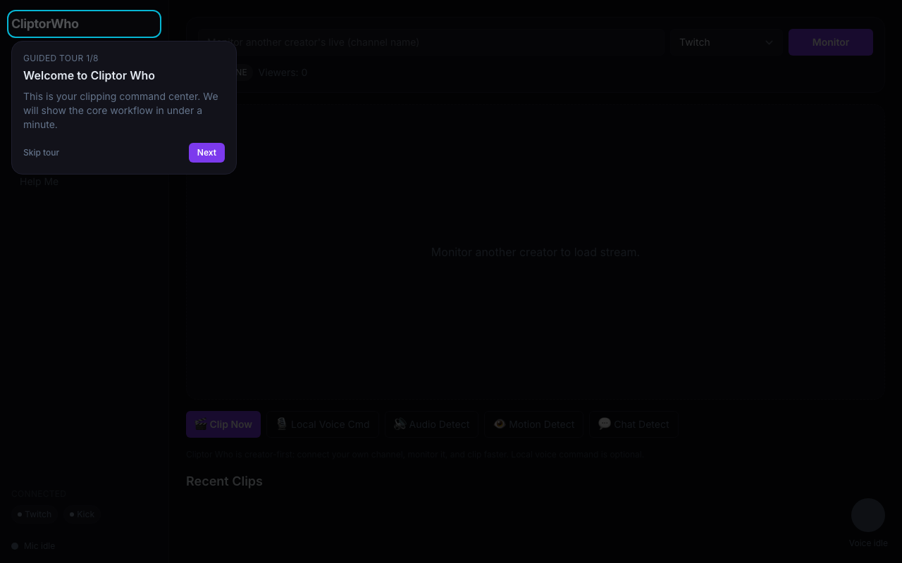
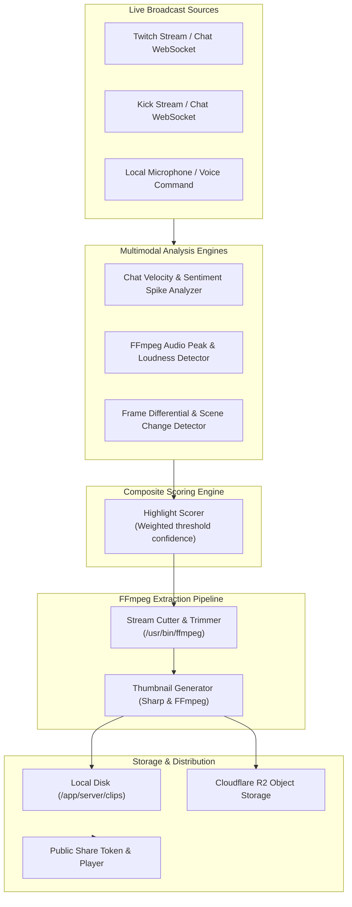

# Cliptor Who

> Full-stack livestream clipping and automated highlight extraction engine for Twitch and Kick.

[](https://react.dev)
[](https://nodejs.org)
[](https://ffmpeg.org)
[](https://github.com/WiseLibs/better-sqlite3)
[](LICENSE)

Cliptor Who is a creator-first clipping command center that monitors live broadcasts, detects highlight-worthy moments across multiple sensory channels (chat velocity spikes, audio amplitude peaks, and frame motion differentials), and extracts shareable clips via FFmpeg pipelines.

---

## Command Center Preview


*Interactive clipping dashboard showing live stream monitor, detection modules (Audio, Motion, Chat), and guided onboarding workflow.*

---

## Highlight Detection & Extraction Pipeline

Cliptor Who evaluates livestreams using three coordinated detection layers before extracting video segments:



---

## Core Capabilities

- **Multimodal Highlight Detection**:
  - **Chat Velocity**: Connects to Twitch and Kick IRC/WebSockets to monitor message density bursts and hype emote surges.
  - **Audio Peak Detection**: Analyzes audio loudness (`ebur128` / volume metrics) to identify shouting, laughter, or sudden gameplay events.
  - **Motion Analysis**: Computes pixel-difference metrics across sampled video frames to flag fast-paced gameplay action.
- **Instant & Voice-Triggered Clipping**: Trigger retroactive 30–60 second clips on demand or via local browser voice commands.
- **Precision Trimming & Thumbnails**: Interactive in-browser trim scrubber backed by millisecond-accurate FFmpeg cuts and Sharp thumbnail generation.
- **Storage Guardrails & Retention Policies**:
  - Dual storage backend: Local disk or Cloudflare R2 object storage.
  - Configurable disk quota cap (`MAX_STORAGE_GB` / `MAX_STORAGE_BYTES`) to prevent out-of-disk failures.
  - Automated retention sweep worker (`RETENTION_SWEEP_MINUTES`) that purges expired assets according to configured rules.
- **Multi-User Security & Session Protection**:
  - Twitch OAuth 2.0 and encrypted Kick API key storage utilizing `CONNECTION_ENCRYPTION_KEY` at rest.
  - User-scoped clipping collections and public read-only share tokens (`/api/share/:token`).

---

## System Architecture

```text
├── client/                 # React 18 frontend (Vite, TailwindCSS, Recharts, Lucide)
│   ├── src/components/     # Stream player, audio meters, chat activity graph
│   └── dist/               # Production single-page application bundle
├── server/                 # Express backend and media worker
│   ├── routes/             # Authentication, clips, stream monitoring, settings
│   ├── services/
│   │   ├── clipper.js      # FFmpeg segmentation and video transcoding
│   │   ├── chatMonitor.js  # WebSocket chat activity listener
│   │   ├── audioAnalyzer.js# Loudness and amplitude spike detection
│   │   ├── motionAnalyzer.js# Scene transition and frame differential analyzer
│   │   ├── highlightScorer.js# Composite confidence scoring algorithm
│   │   ├── objectStorage.js# S3 / Cloudflare R2 presigned transport
│   │   └── storagePolicy.js# Quota enforcement and retention sweeping
│   └── db/                 # SQLite database schema and persistence
├── Dockerfile              # Unified single-container Coolify build definition
└── docs/screenshots/       # Dashboard and workflow interface documentation
```

---

## Local Development

### Prerequisites

- Node.js 20+
- System `ffmpeg` and `ffprobe` installed and accessible in `PATH`

### 1. Configuration

Create root `.env` from template:

```sh
cp .env.example .env
```

Configure Twitch application credentials in `.env`:
```env
PORT=3001
TWITCH_CLIENT_ID=your_twitch_client_id
TWITCH_CLIENT_SECRET=your_twitch_client_secret
TWITCH_REDIRECT_URI=http://localhost:3001/auth/twitch/callback
SESSION_SECRET=local_dev_session_secret_32_characters_minimum
CONNECTION_ENCRYPTION_KEY=local_dev_encryption_key_32_characters
STORAGE_BACKEND=local
```

### 2. Backend Server

```sh
cd server
npm install
npm start
```

### 3. Frontend Client

In a separate terminal:

```sh
cd client
npm install
npm run dev
```

Open `http://localhost:5173` to access the application.

---

## Production Deployment with Coolify

The application includes a root `Dockerfile` that packages both the built React SPA and the Node.js/FFmpeg backend into a single production container.

### Step 1: Create Application in Coolify

- **Resource Type**: Application -> Dockerfile
- **Repository**: `jsalg-byte/cliptorwho`
- **Dockerfile Path**: `./Dockerfile`
- **Exposed Port**: `3001`

### Step 2: Configure Environment Variables

```env
NODE_ENV=production
PORT=3001
PUBLIC_BACKEND_URL=https://clips.yourdomain.com
FRONTEND_URL=https://clips.yourdomain.com
TRUST_PROXY=true
SESSION_SECRET=<random_secret_32_chars>
CONNECTION_ENCRYPTION_KEY=<random_secret_32_chars>
SESSION_COOKIE_SECURE=true
SESSION_COOKIE_SAMESITE=none
FFMPEG_PATH=/usr/bin/ffmpeg
STORAGE_BACKEND=local
TWITCH_CLIENT_ID=...
TWITCH_CLIENT_SECRET=...
TWITCH_REDIRECT_URI=https://clips.yourdomain.com/auth/twitch/callback
```

*For Cloudflare R2 storage, set `STORAGE_BACKEND=r2` and provide `R2_ENDPOINT`, `R2_BUCKET`, `R2_ACCESS_KEY_ID`, and `R2_SECRET_ACCESS_KEY`.*

### Step 3: Mount Persistent Storage Volumes

Ensure the following paths are mapped to persistent Docker volumes:
- `/app/server/db` — SQLite database files
- `/app/server/clips` — Processed video clips
- `/app/server/thumbs` — Generated clip thumbnails
- `/app/server/uploads` — Incoming upload buffer
- `/app/server/frames` — Scratch frame analyzer directory

---

## Verification

```sh
# Frontend build verification
npm --prefix client run build

# Validate server dependencies and syntax
node --check server/index.js
node --check server/services/clipper.js
node --check server/services/highlightScorer.js
```

---

## License

This project is licensed under the MIT License. See [LICENSE](LICENSE) for details.
